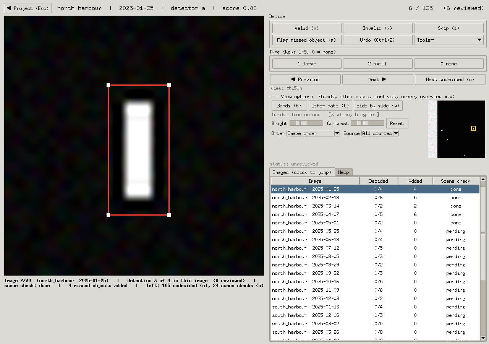
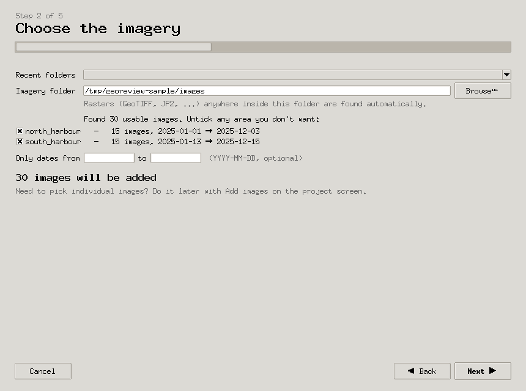
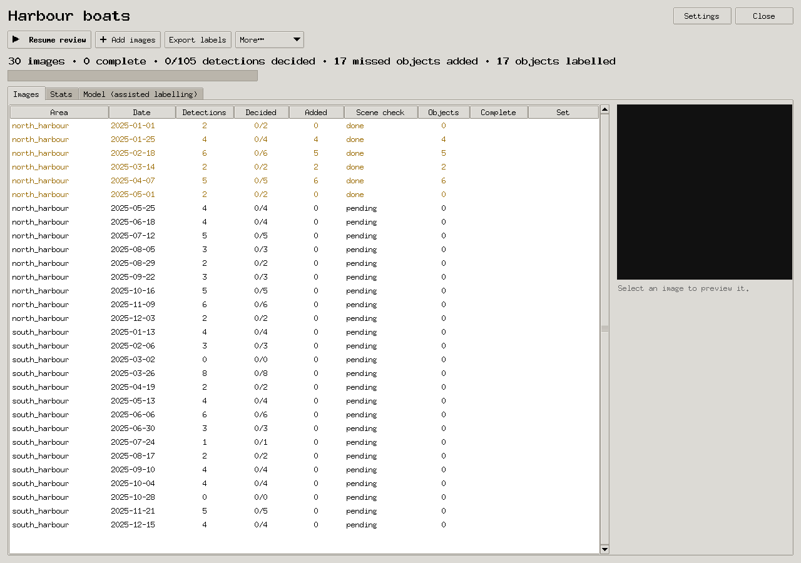
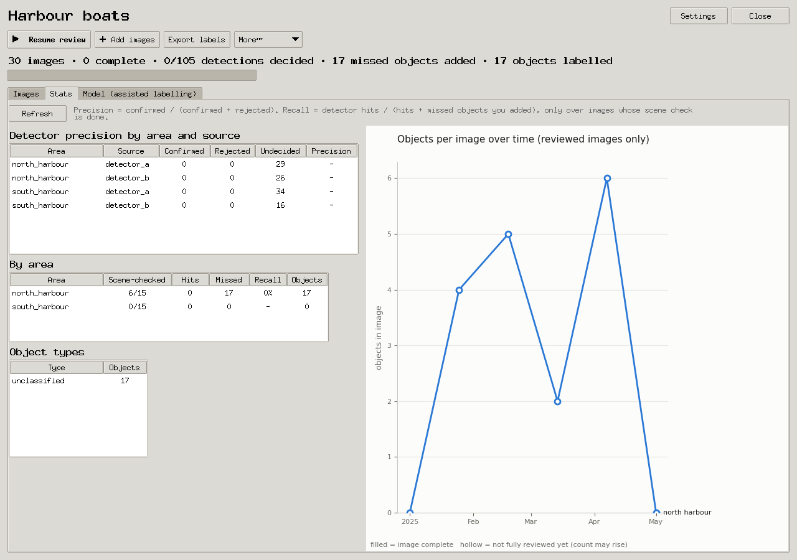

# BoxTrot

**Step through every box.** A desktop app for **reviewing object detections on georeferenced imagery** and turning them into
**validated labels**. Load satellite or aerial images (plus, optionally, a detector's output), go
through each detection (real or not?), fix boxes, mark what the detector missed, then export clean
labels: GeoJSON, CSV and a YOLO training set.

With no detector at all, it helps you **build a labelled dataset from scratch**. It suggests which
images to label first, keeps a blind test set, and (with the optional training add-on) trains a
model on your labels so far that pre-labels the rest for you to correct.



## Features

- **Any georeferenced raster** GDAL can read (GeoTIFF, COG, JP2, ...), in projected or geographic
  coordinates, of any size (large scenes are read at reduced resolution).
- **Guided setup**: a 5-step wizard. Choose the imagery and detections, say what you're labelling
  (and optionally its types), and pick how to start.
- **Fast review**:
  - one-key decisions (`v`/`x`/`s`); number keys are "valid as type N"
  - drag a box's corners to fix it; flag missed objects
  - undo for everything; every decision is saved instantly, plus an audit log
- **Context while reviewing**:
  - band views (true colour, NIR false colour, SWIR, water index)
  - flick to the same place on another date, or a side-by-side window
  - brightness/contrast; an overview map
  - sort detections by score; filter by detector
- **Whole-image checks** so missed objects get labelled too, and "complete" images can safely be
  used for training.
- **Stats**: detector precision per area and source, recall against the missed objects you
  flagged, objects per image over time.
- **Model-assisted labelling** (optional add-on): blind hold-out set, diversity- and
  uncertainty-based image suggestions, training, scoring on the hold-out, pre-labels, a learning
  curve and advice on when to retrain or stop.

| Setup wizard | Dashboard | Stats |
|---|---|---|
|  |  |  |

## Install

Python 3.10+ with Tk. **conda (recommended)**, because it installs GDAL/rasterio reliably:

```bash
git clone https://github.com/mikechirico/boxtrot.git
cd boxtrot
conda env create -f environment.yml
conda activate boxtrot
pip install -e .
boxtrot
```

**pip**: `pip install -e .` also works where rasterio wheels are available (Linux, macOS,
Windows on recent Python). Tk ships with the python.org installers. On Debian/Ubuntu's system
Python you may need `sudo apt install python3-tk`.

### Optional: model training add-on

```bash
pip install ./addons/boxtrot-ultralytics
```

This enables **Train model** / **Predict** on the Model tab, using
[Ultralytics YOLO](https://github.com/ultralytics/ultralytics). It is a **separate package under
the AGPL-3.0** (because Ultralytics is). BoxTrot itself is MIT and works fully without it.
Other detectors can be plugged in the same way; see
[Writing a training backend](#writing-a-training-backend).

## Quickstart (5 minutes, sample data)

```bash
python scripts/make_sample_data.py ~/boxtrot-sample
boxtrot
```

1. **New project** → name it → imagery folder `~/boxtrot-sample/images` (two areas, 30 scenes).
2. Detector output: **Yes** → `~/boxtrot-sample/detections`.
3. Objects: `boat`; optionally the types `large, small`.
4. Start: **Review the detector's output** → **Start review**.
5. For each red box press `v` (real) or `x` (not). Drag a corner to fix a box. On each image's
   **scene check**, press `a` and drag a box around anything without one, then `v`.
6. **Export labels** writes `labels.geojson`, `negatives.geojson`, `image_summary.csv` and a
   `yolo/` dataset of the complete images.

The sample is synthetic (bright objects on dark water), so it's for learning the workflow, not
for judging detectors. `truth.json` has the true boxes.

## Inputs

**Imagery**: a folder of rasters, searched recursively. An image's **area** is its first sub-folder
below the chosen folder (`imagery/north/2024/img.tif` → `north`), or the folder's own name for
images at the top level. Keep the layout stable once you start reviewing: areas are part of the
review IDs. RGB bands are found from band names (`red`/`green`/`blue`, or Sentinel-2
`B04`/`B03`/`B02`), else bands 1-3 for 8-bit images, else 3-2-1 (override in Settings → Advanced).
NIR/SWIR bands (named `nir`/`B08`, `swir16`/`B11`, `swir22`/`B12`) enable the extra band views.

**Detections (optional)**: GeoJSON FeatureCollections, one per image, matched by name and area
folder: `north/scene_042.tif` ↔ `north/scene_042.geojson` or `scene_042_detections.geojson`
(also `_dets`, `_predictions`, `_preds`, `_labels`; Sentinel-2 product IDs are matched inside longer
names). Any geometry works: points, boxes or polygons, lines. Optional feature properties:

| property | meaning |
|---|---|
| `score` | detector confidence, shown and sortable |
| `source` | detector name, filterable (e.g. when combining two detectors) |
| `bbox_w_px`, `bbox_h_px` | box size in image pixels, for point detections |
| `kind: "scene"` + `view_radius_m` | a custom whole-area check item instead of the default whole image |

## Outputs

Everything lives in the project folder and is saved as you go (atomic writes):

```
<project>/project.json                    settings, selected imagery (format_version 2)
<project>/review_data/review_state.json   one record per decided detection / scene check
<project>/review_data/manual_additions.geojson   objects you drew
<project>/review_data/history.jsonl       append-only log of every action (with before-state)
<project>/models/                         model-assisted labelling: hold-out, suggestions, versions
<project>/exports/<date-time>/            labels.geojson, negatives.geojson, image_summary.csv, yolo/
```

`labels.geojson` features carry `label_source`: `detection_confirmed`, `detection_edited`,
`detection_edited_unmarked` or `manual_addition`, plus `class`, `review_id` and the image path.

## Model-assisted labelling

The **Model** tab walks you through it, with one *next step* button:

1. **Hold-out**: a diverse ~15% of images (5-20) labelled **blind**, with no detector or model
   boxes shown, and used only to score models.
2. **Suggested images**: the most varied images first. Once a model exists, it suggests the images
   where it is least sure.
3. **Train** (add-on): runs in the background. The images are tiled exactly as you see them, and
   small objects are upscaled to about 16 px. The model is scored on the hold-out (precision,
   recall, F1, count correlation).
4. **Predict**: pre-labels only images nobody has touched (source `model_vN`, with scores).
   Review them lowest-score first.
5. **Repeat**: it says when to retrain, and when the learning curve has flattened.

Rules of thumb it starts from:
- about 150 labelled objects in about 20 complete images, 1.5× that for objects under 12 px
- at least 50 examples per type before training per type (otherwise one class, plus `other`)
- pre-labels are "useful" at hold-out recall ≥ 0.6 and precision ≥ 0.5

The learning curve on your own hold-out overrides all of these.

## Keyboard shortcuts (review screen)

| key | action | key | action |
|---|---|---|---|
| `v` `x` `s` | valid / invalid / skip | `1`–`9`, `0` | valid as type N / clear type |
| `a` | flag a missed object (drag) | `e` | redraw the box |
| `Ctrl+Z` (`⌘Z`) | undo anything | `X` | reject the rest of this image |
| `←` `→` | previous / next | `u` / `n` | next undecided / next scene check |
| `b` | band views | `t` / `w` | other date (flick / side by side) |
| `-` `+` wheel | zoom | drag, right-drag, `Shift`+arrows, `c` | pan, re-centre |
| `r` / `d` | review added boxes / delete one | `Esc` | back to the dashboard |

## Read this before trusting the output

- **Train only on complete images**: those with every detection decided and the scene check done.
  An unchecked image silently contains unlabelled objects, which become false negatives in
  training. The export does this by default.
- **"0 detections" on an image usually means its detection file wasn't matched** (naming), not
  that the detector found nothing.
- **Hold-out scores are only honest if the hold-out was labelled blind and completely.**
  Pre-labels make reviewers accept model boxes and miss what the model missed. Keep doing scene
  checks.
- **Recall in Stats is against the objects you flagged as missed**, so it's an upper bound.
- **Editing a detection's box marks it Valid by default** (Settings). Edited-but-undecided
  detections from older projects count as objects on export unless you turn that off.

## Development

```bash
pip install -e ".[dev]"
ruff check src tests scripts addons
pytest -m "not gui"          # core + assisted-labelling pipeline (fast; uses a test backend, no ML)
pytest -m gui                # drives the real app; needs a display (CI: xvfb-run)
pytest addons/boxtrot-ultralytics/tests   # real YOLO training run (needs the add-on)
```

Code layout: `src/boxtrot/core/` (project model, rendering, export, assisted labelling; no GUI,
no ML), `src/boxtrot/ui/` (Tkinter), `src/boxtrot/testing.py` (synthetic data + an oracle
backend), `addons/` (separately licensed plugins). See [CONTRIBUTING.md](CONTRIBUTING.md).

### Writing a training backend

A backend is any package exposing an object with `name`, `label`, `default_weights`,
`train(data_yaml, base_weights, epochs, imgsz, batch, out_dir, on_epoch)` and
`load(weights).predict(tiles, imgsz, conf)`, registered under the entry point
`boxtrot.trainers`. The full contract is in
[`core/backends.py`](src/boxtrot/core/backends.py); the reference implementation is
[`addons/boxtrot-ultralytics`](addons/boxtrot-ultralytics). For quick experiments, set
`BOXTROT_BACKEND=module:attribute`.

## License

MIT (see [LICENSE](LICENSE)). The optional training add-on in `addons/boxtrot-ultralytics` is a
separate package under AGPL-3.0, with its own LICENSE.
